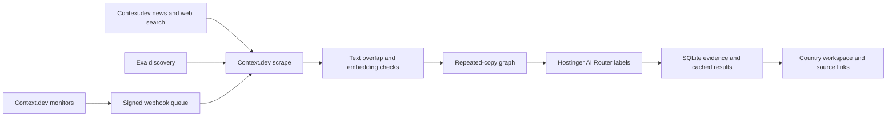
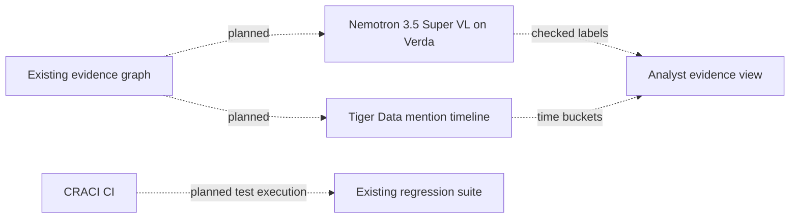

# Signal Fire

Inspect news sites that repeatedly publish the same stories close together, with the source pages and matched text attached.

[Open Signal Fire](https://signal-fire.72.61.22.106.sslip.io) · [Evaluation ledger](eval/LEDGER.md) · [Deployment notes](deploy/README.md)

Built by Shreyansh, team The CS Guy, for Junction 2026. The same product has two main entries: Hostinger's Decode the Noise and Context.dev's The Web Is Your Real-Time Database.

## Follow the evidence

Choose a country, open a copied story and inspect the pages, publication times and shared wording behind it. The site groups repeated publication behaviour so a newsroom analyst can decide what to investigate next.

Findings do not identify who paid for a network, establish that an account is a bot, or prove that one source caused another to publish. Ordinary syndication and translations remain plausible explanations.

## Current architecture



The Node.js service and durable scheduler run on a Hostinger VPS. The live product does not need the builder's Mac. Context.dev provides changing source pages and monitor events; SQLite retains evidence, provider-call records and cached results.

The country engine confirms copies with word-sequence overlap and another embedding check. Its configured graph rules include a 60-minute window and groups of at least three sites and three stories. Those values are rule settings, not measured accuracy. Cited origins and infrastructure information support investigation.

Separate model families through Hostinger AI Router must accept narrative labels. Gemini 3.5 participates in grouping/filtering; GPT-4.1 mini and Claude Haiku support label checks. Exact provider routing can change with configuration. These models help describe evidence; agreement between them does not prove coordination.

## Sponsor use and planned additions

| Service | Status and concrete role |
| --- | --- |
| Hostinger | Implemented. VPS hosts the service and worker. AI Router supplies model calls. |
| Context.dev | Implemented in the core flow. News/web search, scrape and monitors supply the linked evidence and live updates. |
| Exa | Implemented for candidate-page discovery. |
| Gemini | Implemented through Hostinger AI Router. This is routed model access, not a claimed direct Google API connection. |
| Codex | Used to develop, debug and verify the product. |
| CRACI | **Planned, not implemented.** Run the existing tests and contracts on CRACI. |
| NVIDIA Nemotron | **Planned, not implemented.** Add a bounded evidence-label step using the required Nemotron 3.5 Super VL model. |
| Verda | **Planned, not implemented.** Host the Nemotron inference step on Verda compute. Model availability and deployment are not yet proven. |
| Tiger Data | **Planned, not implemented.** Store the mention timeline in time-series PostgreSQL and compute time buckets for the analyst view. SQLite is still the current store. |

Sponsor selections are saved on both main-entry drafts. Planned selections still need working implementation and evidence before they can support a prize claim.

## Run locally

Use Node.js 24. Supply `CONTEXT_DEV_API_KEY`, `HOSTINGER_AI_ROUTER_API_KEY` and `EXA_API_KEY` securely through the process environment for live provider paths. No credential belongs in the repository.

```bash
npm ci
npm start
```

The server listens on `127.0.0.1:4321`. `SIGNAL_DATA` selects a persistent SQLite/cache directory. Provider credentials, a writable persistent directory and configured sources are required for live collection.

Collection is separate from opening the UI. Enable `SIGNAL_SCHEDULER=1` only after configuring provider access and collection controls. This flag can start the older worker as well as the country scheduler; `V2_SCHEDULER=0` disables the latter. Do not enable unattended collection merely to preview the interface.

## Verify behaviour

```bash
npm test
```

On the deployed site, open a country detail page, inspect a real story and follow its original sources. Check the signed-event trail when validating monitor updates. Use a separate test watch for write checks. The home page currently has readiness labels that disagree with working country detail pages; the detail evidence is the useful inspection path.

## What the results establish

The current country engine has no frozen held-out detection evaluation yet. Its live findings and monitor count demonstrate activity, not detection accuracy or early warning.

An older watch-engine replay caught 7 of 32 known-network publication sets, missed 25 and falsely flagged 0 of 32 controls. These are measured historical results for conditional verification of retrieved sets. They do not validate the newer country engine or establish a general false-positive rate. Search-index omissions can prevent discovery before any classifier runs.

See the [evaluation ledger](eval/LEDGER.md) and `artifacts/benchmark/` for recorded experiments. Do not present older content-screening or seeded results as current country-engine performance.

## Planned architecture and completion checks



After implementation approval, each addition needs a real receipt. CRACI needs a successful `runs-on: craci` job. Nemotron/Verda needs a visible core model step, recorded model identity, a frozen comparison against the current labels and its runtime/cost. Tiger Data needs persisted timestamps and reproducible time-bucket queries that power the timeline. None of these checks has run for the planned services.

## Code map

`v2/` contains the country engine, API, database, live feed and scheduler. `signal/server.mjs` starts the service. `eval/` and `artifacts/` hold experiment records. External pages remain the publishers' content; preserve source links and attribution when reusing findings.
