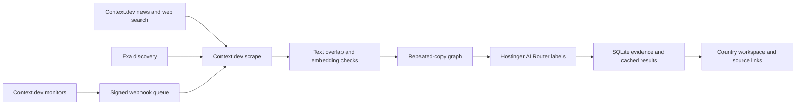
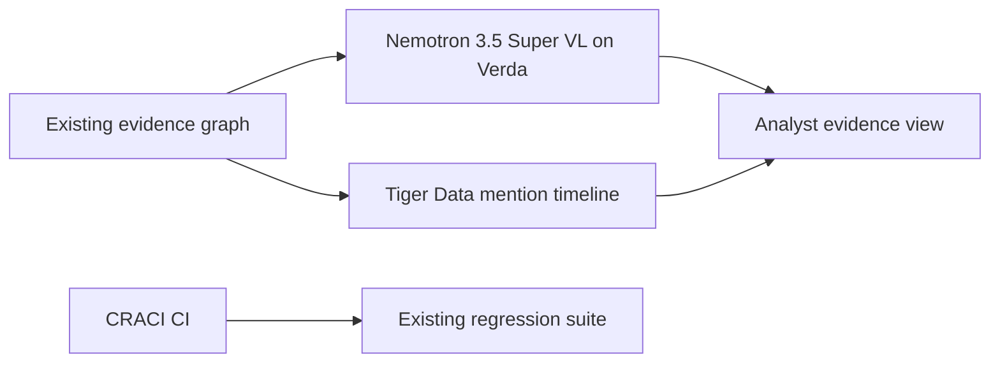

# Signal Fire

Inspect news sites that repeatedly publish the same stories close together, with the source pages and matched text attached.

[Open Signal Fire](https://signal-fire.72.61.22.106.sslip.io) · [Evaluation ledger](eval/LEDGER.md) · [Deployment notes](deploy/README.md)

Built by Shreyansh, team The CS Guy, for Junction 2026. The same product has two main entries: Hostinger's Decode the Noise and Context.dev's The Web Is Your Real-Time Database.

## Follow the evidence

Choose a country, open a copied story and inspect the pages, publication times and shared wording behind it. The site groups repeated publication behaviour so a newsroom analyst can decide what to investigate next.

Findings do not identify who paid for a network, establish that an account is a bot, or prove that one source caused another to publish. Ordinary syndication and translations remain plausible explanations.

## Current architecture



The Node.js service and durable scheduler run on a Hostinger VPS. The live product does not need the builder's Mac. Context.dev provides changing source pages and monitor events; SQLite retains evidence, provider-call records and cached results.

The country engine confirms copies with word-sequence overlap and another embedding check. Its configured graph rules include a 60-minute window and groups of at least three sites and three stories. Those values are rule settings, not measured accuracy. Cited origins and infrastructure information support investigation.

Separate model families through Hostinger AI Router must accept narrative labels. With the Verda credential configured, NVIDIA Nemotron 3.5 Super VL must also accept each proposed label; unavailable or malformed output withholds it. Gemini 3.5 participates in grouping/filtering; GPT-4.1 mini and Claude Haiku support label checks. Exact provider routing can change with configuration. These models help describe evidence; agreement between them does not prove coordination.

## Sponsor use and planned additions

| Service | Status and concrete role |
| --- | --- |
| Hostinger | Implemented. VPS hosts the service and worker. AI Router supplies model calls. |
| Context.dev | Implemented in the core flow. News/web search, scrape and monitors supply the linked evidence and live updates. |
| Exa | Implemented for candidate-page discovery. |
| Gemini | Implemented through Hostinger AI Router. This is routed model access, not a claimed direct Google API connection. |
| Codex | Used to develop, debug and verify the product. |
| CRACI | Implemented workflow configuration in `.github/workflows/sponsor-ci.yml`, running the real regression suite on `runs-on: craci`. Successful runner execution is required as verification. |
| NVIDIA Nemotron | Implemented. `nemotron-3.5-super-vl` checks whether proposed narrative labels are neutral and supported by the supplied headlines. A configured check must accept the label before publication. |
| Verda | Implemented. The organizer-provided Verda-hosted event endpoint runs the Nemotron check. Model identity, verdicts, latency and returned token usage are retained; a price is not inferred. |
| Tiger Data | Implemented. A TLS-verified PostgreSQL connection persists narrative-specific source mentions in a TimescaleDB hypertable. Native `time_bucket` queries supply the 30-day timeline. SQLite continues to store the rest of the evidence and cached views. |

Sponsor verification is separate from selection. The code includes real-provider receipts and deployment acceptance checks. An actual successful CRACI job is required in addition to its workflow configuration.

## Run locally

Use Node.js 24. Supply `CONTEXT_DEV_API_KEY`, `HOSTINGER_AI_ROUTER_API_KEY` and `EXA_API_KEY` securely through the process environment for live provider paths. No credential belongs in the repository.

```bash
npm ci
npm start
```

The server listens on `127.0.0.1:4321`. `SIGNAL_DATA` selects a persistent SQLite/cache directory. Provider credentials, a writable persistent directory and configured sources are required for live collection.

Collection is separate from opening the UI. Enable `SIGNAL_SCHEDULER=1` only after configuring provider access and collection controls. This flag can start the older worker as well as the country scheduler; `V2_SCHEDULER=0` disables the latter. Do not enable unattended collection merely to preview the interface.

## Verify behaviour

```bash
npm test
```

On the deployed site, open a country detail page, inspect a real story and follow its original sources. Check the signed-event trail when validating monitor updates. Use a separate test watch for write checks. The home page currently has readiness labels that disagree with working country detail pages; the detail evidence is the useful inspection path.

## What the results establish

The current country engine has no frozen held-out detection evaluation yet. Its live findings and monitor count demonstrate activity, not detection accuracy or early warning.

An older watch-engine replay caught 7 of 32 known-network publication sets, missed 25 and falsely flagged 0 of 32 controls. These are measured historical results for conditional verification of retrieved sets. They do not validate the newer country engine or establish a general false-positive rate. Search-index omissions can prevent discovery before any classifier runs.

See the [evaluation ledger](eval/LEDGER.md) and `artifacts/benchmark/` for recorded experiments. Do not present older content-screening or seeded results as current country-engine performance.

## Sponsor implementation and verification



`v2/nemotron.mjs` calls the required event model, validates one boolean verdict per input label, caches exact inputs and bounds daily attempts. It records the model and token counts without inventing a dollar price. Measured canary checks accepted two existing public narrative labels in 675 ms and rejected two deliberately unsupported labels in a separate 522 ms controlled probe. This is a narrow regression check, not population accuracy or the missing country-engine benchmark.

`v2/tiger.mjs` persists each narrative's own source membership, deduplicates retries and replaces corrected timestamps. `time_bucket` supplies 30 UTC daily positions so sparse observations cannot shift dates on the chart. Older records contain only linked examples, so their timeline explicitly says so. A real canary ingestion retained six distinct source pages in two narrative buckets, with PostgreSQL confirming TLS 1.3. These are measured operational receipts, not a claim of full publishing coverage.

Provider credentials remain encrypted at rest and load into server memory. Configure `VERDA_INFERENCE_KEY` and `TIGER_DATABASE_URL` securely, with `TIGER_CA_CERT_B64` only if a trusted custom CA is necessary. TLS verification is never disabled. Run `scripts/upgrade-sponsors.mjs --country=IR` on the existing evidence dataset to add real checks and timelines without rebuilding web searches.

`SIGNAL_URL=<deployed URL> EXPECTED_COMMIT=<commit> node scripts/sponsor-v2-e2e.mjs` follows the current briefing, evidence and copy timeline, then verifies the visible Nemotron/Tiger output at desktop and phone sizes. CRACI requires a successful real `runs-on: craci` job. No portal or submission description is changed by these checks.

## Code map

`v2/` contains the country engine, API, database, live feed and scheduler. `signal/server.mjs` starts the service. `eval/` and `artifacts/` hold experiment records. External pages remain the publishers' content; preserve source links and attribution when reusing findings.
